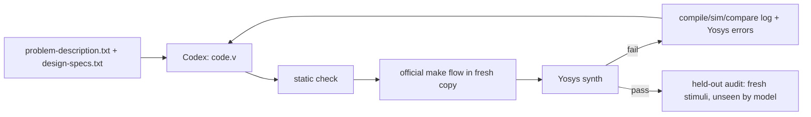

# ArchXBench Levels 4–6

[ArchXBench](https://github.com/sureshpurini/ArchXBench) ([paper](https://arxiv.org/abs/2508.06047),
MLCAD 2025) is a Verilog benchmark of datapath-heavy designs. Levels 4–6 cover pipelined
IEEE-754 units, FIR filters, FFTs, DCT, image-processing pipelines, systolic GEMM, AES cores,
3D convolution and quantized matrix multiplication. In the paper, every evaluated model
solved at most 3 of these 22 problems.

We applied this repository's compile→test→repair loop, using Verilog instead of VHDL because
the benchmark's testbenches are Verilog. Results were recorded on **27 September 2026**
against ArchXBench v1.5 (`0db0d0d`), with the Codex CLI running `gpt-6-astra` (reasoning
`xhigh`) and at most 8 rounds per problem.

## Result

| | Level 4 (6) | Level 5 (6) | Level 6 (9) | Total (21) |
| --- | ---: | ---: | ---: | ---: |
| Paper: best of Sonnet 4 / GPT-4.1 / o4-mini-high / R1, zero-shot pass@5 | 2 | 0 | 1 | **3** |
| This loop, round 1 only (zero-shot, pass@1) | 5 | 2 | 4 | **11** |
| This loop, ≤ 8 rounds (pass@1) | 6 | 6 | 9 | **21** |
| …also passes held-out audit (3 fresh stimulus sets) | 6 | 6 | 9 | **21** |
| …also completes full Yosys synthesis | 6 | 6 | 7 | **19** |

All 21 designs pass the official testbench and scorer. Each design passes all three held-out
audits. We found no published Level 4–6 results beyond the paper. The model used 80 minutes
of Codex time in total. Eleven problems passed on round 1, 19 within two rounds, and
`unsharp_mask` on round 8. The full synthesis of `multich_conv2d` and
`quantized_matmul` exceeded 12 GB or one hour. Both still pass Yosys elaboration, `proc`,
flattening and `check -assert` without inferred latches.

The paper evaluated benchmark v1 with fixed and inverse FFT listed separately, so it counts
22 problems. Version 1.5 combines them and fixes testbenches that could fail correct or pass
incorrect designs. Its model generation is older and it did not use feedback. The round-1 row
isolates model improvement: the same zero-shot protocol gives 11, compared with 3. The loop
adds the remaining 10.

## Protocol



- The model receives only `problem-description.txt` and `design-specs.txt`, as in the
  paper. It never sees `tb.v`, golden data, scripts, or audit results.
- Each round copies the pristine problem into a networkless container and runs its official
  `make all` flow. Both FP pipeline problems run `iverilog tb.v code.v`.
- Feedback contains compiler errors, a truncated simulation/compare log, and Yosys errors.
  Since the graded testbench supplies feedback, this is the standard AutoChip-style upper
  bound, not a blind score.
- Static checks reject file I/O, `$display`, `$finish`, delays, `include`, and upward
  hierarchical references. Otherwise a DUT could write `outputs/dut_output.json`, print
  `PASS`, or read testbench goldens.
- Port-correct stub modules fail all 21 problems. A deliberately faulty FP adder fails 6%
  of audit vectors, as expected.

## Held-out audit

Because feedback comes from the graded testbench, every selected design was rerun with
three new seeded stimulus sets. Goldens come from the benchmark's reference scripts, or
from an independent reference where none exists. The testbench and scorer are unchanged
except where the official test fixes the value being varied.

| Problem | Official test | Audit |
| --- | --- | --- |
| Fixed-point FIRs | One 1,000-sample signal and filter | Random symmetric coefficients, random full-range input and saturation steps |
| FP FIRs | One float filter and signal | Random symmetric float filters and inputs |
| FP adder, multiplier | 23 / 31 hand-picked cases | 12,000 streamed ops back-to-back: all bit-exact, including subnormals, infinities and NaNs |
| FFT16/IFFT, DCT, FFT64 | Fixed sinusoids | Random complex/real frames |
| conv1d, conv2d, unsharp mask, Harris | Sines, test images | Random images with flat regions and edges |
| conv3d | One fixed kernel in `tb.v` | Random binary kernels in `tb.v` and the reference, random volumes |
| multi-channel conv2d | Astronaut image, fixed filters | Random RGB image, random int8 kernels and biases |
| Systolic GEMM | 1..16 × 1..16 and an identity matrix | Random signed 31-bit matrices |
| AES enc/dec | Four SP 800-38A blocks, one key | 64 random blocks with a different key for each |
| Quantized matmul | Seed 42 | Seeds that keep all quantized values within INT8 |

## Selection and synthesis

The report selects the first round that passes the official flow and completes Yosys
synthesis. The loop falls back to the first official pass without a Yosys error when none
is synthesizable within the resource limit. For the two AES cores and two FP FIRs, the
first functional design exceeded synthesis limits, and a later round provided a smaller,
synthesizable design.

A Yosys process killed for exceeding memory is not a design error. Early in the run, the
loop reported such kills to the model as synthesis failures. This cost `multich_conv2d` an
extra round after its functional pass. The code now reports them as inconclusive. Generic cell counts are shown in
[`archxbench-results.json`](archxbench-results.json) only as a size indication; they are
not Vivado utilisation. FIR counts are nearly zero because `tb.v` writes the required
`coeffs_mem` hierarchically, and synthesis removes the unwritten array's datapath.

## Architecture review

The paper also rejects functionally correct designs that ignore the requested architecture.
We inspected the designs and the model's notes; this was not an exhaustive review. The FP
units accept one operation per cycle. The systolic array generates 16 processing elements.
The AES encryption core has ten pipeline stages and carries a key with each block. `fft_streaming_64pt` uses six
spatial radix-2 stages with frame buffering and natural-order output.

`fft_streaming_64pt` registers inputs on the falling clock edge. Its testbench, and 11
others, drive DUT inputs with blocking assignments immediately after `@(posedge clk)`. The
model attributed failures to this race. With stable inputs, the falling-edge register
remains correct, but it is an unusual interface.

## Benchmark issues found

- Twelve testbenches assign inputs with blocking assignments at the same active edge the DUT
  samples. Icarus orders this consistently, but it rewards falling-edge or bypass
  workarounds. It probably caused most of `unsharp_mask`'s seven failed rounds.
- `systolic_gemm` prints its 64-bit results as unsigned while its golden is signed. The
  official vectors are positive, so negative products are never tested. Our audit compares
  two's-complement bit patterns.
- `conv3d` specifies runtime kernel input but its testbench always uses one kernel.
- Several official tests are weak: AES uses four public vectors, GEMM uses an identity
  matrix, and conv1d uses 16 samples.

## Reproduce

```bash
git clone https://github.com/sureshpurini/ArchXBench ../ArchXBench  # tested at 0db0d0d
podman build -t xls-e2e-archx:local -f Dockerfile.archx .
fpga-lab archxbench ../ArchXBench --out runs/archx --rounds 8 --workers 6
fpga-lab archxbench ../ArchXBench --out runs/archx --finalize --tool-jobs 1
fpga-lab archxbench ../ArchXBench --out runs/archx --audit
```

The Podman VM used 14 CPUs and 20 GB for finalize and audit. The selected Verilog and
model notes are in [`examples/archxbench/generated`](../examples/archxbench/generated).
This is one run for each problem; variance across seeds and models has not been measured.
