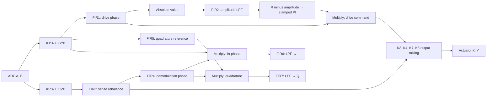

# Programmable MEMS gyro controller: image to Verilog to Sky130

The implementation is a digital control/DSP macro. It has two ADC sample inputs,
two actuator command outputs, demodulated I/Q outputs, and AGC gain telemetry.
It does not include the MEMS structure, ADCs, DACs, analog front end, pad ring,
package, or a shuttle-specific wrapper. A successful macro layout is not a
completed chip tapeout. Sensor calibration and system stability remain separate
acceptance criteria.

## Sources and interpretation

The user supplied `ml_test.png` and *Algorithm and Low Power Digital
Implementation for MEMS Inertial Sensors*, M'Closkey, Daneshrad, and Gibson,
MICRO Project 99-083 final report, 1999–2000. Figure 1 on PDF page 3 is more
legible than the image: use its wiring as the topology authority. The PDF prose
also says “drive mode feedback” in the demodulation paragraph, while the figure
connects the sense feedback through FIR4. This implementation follows the figure.

Source SHA-256:

- PDF: `a94bda7a91177cf3f17f5f37e197c1446a733212155094608ac083f44b97a34c`
- Image: `f834aa036c79988ed7870f67c1b7e65e6daf311967209a485c17373c024aeaa7`

The paper omits filter coefficients, gains, binary points, limiter settings,
rounding rules, interface protocol, and identified mechanical dynamics. It
mentions both 20- and 22-bit internal precision. These are not recoverable from
the drawing. This implementation chooses the explicit contract below and provides
programmable coefficients. It is not a bit-exact reconstruction of the 2000 chip.
The paper's process, power, and maximum clock measurements are not predictions
for this Sky130 implementation.

## Signal equations

Signal-path multiplications shift right by 16 and saturate to signed 22 bits;
signal-path additions/subtractions also saturate to 22 bits. The integral update
keeps the shifted `Ki*e` product at full precision before clamping its 24-bit state.
FIR sums accumulate all full products before shifting once and saturating.
All seven FIRs are causal:
`FIRj(x)[n] = sat22(sum(cj[k] * x[n-k]) >> 16)`.

```text
d = K1*A + K2*B                      drive-mode measurement
s = K5*A + K6*B                      sense-mode measurement
v = FIR1(d)                          drive phase compensation
a = FIR2(sat22(abs(v)))              rectified amplitude estimate
e = R - a
p = Kp*e
integral = clip(integral + ((Ki*e) >> 16), Imin, Imax)
u = clip(sat22(p + integral), Umin, Umax)
drive = v*u
feedback = FIR3(s)                   sense rebalance compensation
demod = FIR4(feedback)               demodulation phase compensation
qref = FIR5(d)                       quadrature reference
I = FIR6(demod*d)
Q = FIR7(demod*qref)
X = K3*drive + K7*feedback
Y = K4*drive + K8*feedback
```



X, Y, I, Q, and u are saturated to 18-bit output codes. Feedback polarity is
programmable through signed coefficients and gains. The integral is updated
before calculating u for the same sample. It uses a clamped 24-bit state, not
conditional integration or back-calculation anti-windup. Ki already includes
the chosen sample period. R specifies **mean absolute filtered velocity**, not
automatically the sinusoid's peak amplitude.

## Numerical and cycle contract

| Quantity | Signed width | Fractional bits | Range |
| --- | ---: | ---: | --- |
| ADC and result codes | 18 | 16 | -2 to 2 − 2^-16 |
| Coefficients, K1–K8, Kp, Ki | 18 | 16 | -2 to 2 − 2^-16 |
| Internal signal, R, output limiter | 22 | 16 | -32 to 32 − 2^-16 |
| Integral state and limits | 24 | 16 | -128 to 128 − 2^-16 |
| Shared multiplier product | 44 | 32 | Full signed product |
| FIR accumulator | 49 | 32 | No overflow for 128 legal 22×18-bit terms |

Right shifts round negative values toward negative infinity. Arithmetic saturates
at defined boundaries; it never relies on signed wraparound. `abs(-2^21)` clamps
to `2^21-1`. Coefficient zero is the current sample, and coefficient 127 is the
oldest sample. The reference uses shift-list convolution; the RTL independently
uses a circular buffer.

One shared multiplier serves all seven filters and scalar operations. The sample
schedule takes `68 + sum(filter_lengths)` clocks from input acceptance to output
valid becoming asserted. With all seven filters at 128 taps that is 964 clocks.
Consuming the output and accepting a new input takes two further clocks: minimum
initiation interval is 966 clocks without stalls. At the 25 MHz clock verified
by nine-corner extracted timing analysis, this supports about 25.9 ksample/s, above the
paper's 25 ksample/s DSP rate. Output backpressure reduces that rate.

Scalar operations register the source operands, full product, and writeback on
separate cycles. FIR operations overlap multiplication with accumulation using
a registered full product and one drain cycle. This preserves every rounding
boundary while breaking the decode/multiply/accumulate path that missed the slow
corner in the first physical experiment. The initial unpipelined schedule was
931 clocks; the final schedule adds 33 clocks per sample.

The RTL uses register enables and isolates inactive multiplier operands. It does
not generate gated clocks. Coefficients and history are inferred memories that
the initial standard-cell flow maps to registers/multiplexers. This is portable
but larger than an SRAM implementation. No SRAM black box is silently substituted.
Power must be measured with representative switching activity and extracted
parasitics; no mW result is claimed here.

## Interface and configuration

All ports are synchronous to `clk`; `rst` is active-high synchronous reset.
Inputs are accepted only on `in_valid && in_ready`. Outputs are held until
`out_valid && out_ready`, including all five result fields. Only one sample is
in flight. A source must retain a sample until acceptance; this is not a free
running ADC capture FIFO. External asynchronous signals require synchronization
or a proper clock-domain crossing wrapper.

Reset discards in-flight work, clears gains/integral/output state, and sequentially
clears all 896 coefficient/history entries. Ready stays low for 896 clocks after
reset deassertion. Boot is deterministic and produces zero actuator commands
until configured. Reset also clears the calibration: reload it before operation.

Writes occur only on `cfg_valid && cfg_ready`. Configuration has priority over
sample acceptance. Configuration is blocked during computation and while a result
is pending. Each write is atomic; a *sequence* of configuration writes is not.
Keep sample-valid low while loading a complete calibration. Changing coefficients
does not clear history; reset and reload if a fresh filter state is required.

| Address | Meaning | Stored bits |
| --- | --- | --- |
| `0x000–0x37f` | 7 × 128 FIR coefficients, bank 0 = FIR1, address = bank×128 + tap | signed low 18 |
| `0x400–0x407` | K1 through K8 | signed low 18 |
| `0x408`, `0x409` | Kp, Ki | signed low 18 |
| `0x40a` | R | signed low 22 |
| `0x40b`, `0x40c` | integral minimum/maximum | signed 24 |
| `0x40d`, `0x40e` | PI output minimum/maximum | signed low 22 |
| `0x420–0x426` | FIR1–FIR7 length minus one (0 means 1 tap; 127 means 128) | low 7 |

`cfg_wdata` is signed 24 bits; narrower fields take the indicated low bits.
Reserved addresses pulse `cfg_error` after an accepted write and have no effect.
There is no readback or serial transport in this macro. Host-side `Config.validate`
rejects out-of-range values and inverted limits; raw hardware writes must honor
those same preconditions. The original ASIC's unspecified asynchronous serial
interface is not invented here.

## Reproduce verification

The current RTL and Sky130 digital macro passed the following checks. The final
physical report sets `macro_signoff_pass=true`; chip-level `tapeout_ready` remains
false because the shuttle wrapper and analog/system integration are not supplied.

| Check | Recorded result |
| --- | --- |
| Python test suite | 110 passed; 9 tool-dependent tests skipped |
| RTL development and independent-seed regressions | 1,697 outputs each; bit-exact |
| Generic synthesized-netlist replay | 1,697 outputs; bit-exact |
| Direct Sky130 TT mapped-netlist replay | 1,697 outputs; bit-exact |
| Analytic I/Q demodulation | Maximum error 1 output LSB |
| Live RTL feedback experiment | 10,000 samples; zero RTL/oracle error |
| Synthetic plant regulation | Mean absolute drive 0.29875 versus 0.3 target; 17.54 dB sense suppression |
| Extracted nine-corner timing/electrical checks | Zero setup/hold/slew/capacitance violations at 25 MHz; worst setup +13.224 ns, hold +0.00619 ns |
| Final physical-netlist replay | 1,697 outputs; bit-exact; SHA-256 matches the final exported netlist |
| GDS verification | Magic DRC, KLayout DRC, GDS comparison, LVS, overlap, antenna and connectivity checks: zero errors |

The existing `Toolchain` supplies the same networkless, resource-limited Podman
execution as the VHDL/Wi-Fi harness. The extension adds Verilog simulation, a
separate Python oracle, deterministic fixtures, schedule checks, generic synthesis,
mapped replay, and a live feedback experiment.

```sh
.venv/bin/python -m pytest -q
FPGA_LAB_MEMORY=4g .venv/bin/python -m fpga_lab gyro --out runs/gyro-dev --synthesize
.venv/bin/python -m fpga_lab gyro --out runs/gyro-audit-new --seed 92731
.venv/bin/python -m fpga_lab gyro --closed-loop --out runs/gyro-loop-new
.venv/bin/python scripts/plot_gyro_loop.py runs/gyro-loop-new  # optional matplotlib
```

`--prepare-only` writes portable Verilog, vectors, expected results, hashes, and
configuration manifests without requiring tools. The regression covers signed
extremes, mixed lengths, all 128 taps, circular-buffer wrap, FIR overflow bounds,
limiter behavior, input/output handshakes, config exclusion, invalid addresses,
and reset mid-computation. RTL simulation uses four-state Icarus; large mapped
replay uses compiled two-state Verilator with the same scoreboard and stalls.
Generic synthesis results are **not** Sky130 area/timing evidence.

The analytic test drives a carrier at fs/16 with independently known in-phase
and quadrature amplitudes. FIR5 is a four-sample delay, giving -90 degrees at
that one frequency. It is not a broadband Hilbert transformer. The moving-average
low-pass filters and identity compensators are demonstration settings.

The live loop uses Verilator actuator outputs to evolve a Python two-mode damped
resonator over 10,000 samples. Every response is also checked against the integer
oracle. The experiment starts with a small nonzero displacement; a zero-state
oscillator needs a startup kick/noise mechanism in a physical system. It measures
AGC settling and rebalance suppression relative to the same synthetic sense mode
without feedback. This does not establish real-sensor phase margin, noise floor,
rate calibration, temperature tracking, or startup reliability.
The surrogate applies each returned actuator value over the next discrete plant
step; fractional-sample computation time, ADC/DAC delay, and analog dynamics are
not modeled. Those delays must be included when fitting real phase compensators.

The loop defaults to Kp=1.75 and Ki=1/1024, selected after a numerical gain sweep
and then tested with live RTL. Override `--kp` and `--ki` to repeat this tuning.
The initial Kp=0.25 case had large overshoot; the tuned case reached about 4%
peak envelope overshoot and entered a ±5% band after about 39 ms in this plant.
Both cases passed bit-exact RTL comparison. Recorded evidence is in
[`examples/gyro/validation.json`](../examples/gyro/validation.json).

## Sky130 macro flow

The flow uses LibreLane 3.0.16 and its specified Sky130 PDK revision
`8afc8346a57fe1ab7934ba5a6056ea8b43078e71`, with `sky130_fd_sc_hd`.
The configuration targets 40 ns and 35% initial core utilization. It retains
flow DRC, LVS, antenna, timing, and connectivity checks. Pin timing uses the
flow-generated constraints; board/ADC/DAC constraints must replace these when
the system interface is defined.

The generated LEF is 2185.575 × 2196.295 um (about 4.80 mm²). Its physical
supply pins are `VPWR` and `VGND`, exposed on metal 4 and metal 5. The nominal
core supply is 1.8 V. Signal pins are core logic; the chosen chip wrapper must
provide pads, ESD protection, and any required voltage-domain conversion.

Intentional clock-delay cells (`sky130_fd_sc_hd__clkdlybuf*`) are excluded from
general synthesis/resizing. The first experiment selected thousands of these
as ordinary fanout buffers, lengthening control paths. Regular buffers remain
available, and hold checking and repair remain enabled.
Post-CTS and post-global-route hold repair target an additional 10 ps of margin.
The 100 ps and 30 ps targets buffered thousands of already nonnegative hold paths;
the smaller repair target reduces this overhead. Clock uncertainty remains
250 ps, and final setup/hold checks still require zero violations across corners.
Heuristic diode insertion is disabled: the trial using it had 25,895 nominal-corner
slew violations, with inserted diode loads on the violating nets. Measured antenna checking and targeted
jumper/diode repair remain enabled. A Classic-flow substitution runs
`Gyro.ElectricalRepair` after antenna repair, followed by multicorner timing repair.
This step inserts one `clkbuf_8` near the clock input, preserves the balanced
CTS network, and repeats routed electrical repair three times with 20%
slew/capacitance repair margins. Blanket clock-wire buffering was rejected after
it added excessive clock latency and caused hold violations. The focused change
addresses three remaining weak-buffer nets and the clock-entry wire found after
the first electrical repair. External driver assumptions and signoff limits are
unchanged. The Python/Tcl flow extensions are hashed in `inputs.json`.

The first detailed-route/extraction run was DRC-, antenna-, and connectivity-clean,
but extracted electrical checks found violations absent from the global-route
estimate (2,379 slew violations at nominal RC/TT, more at the slow corner).
`Gyro.ExtractedRepair` therefore runs after RC extraction. The first repair used
reduced SPEF models for all nine corners, but left 24,655 slew and 46 capacitance
violations at the worst corner after rerouting. Setup and hold still passed.
The revised step retains the **full max-RC/slow-corner SPEF network** while sizing
same-family drive variants. It uses a 0.45 ns sizing target, then restores the
0.75 ns signoff limit. Buffer selection also uses a temporary 0.16 pF
capacitance target, restoring 0.20 pF for signoff. This margin addresses PVT
variation in pin capacitance: the prior source-buffer run cleared all slew
violations but left one 0.200839 pF net at max-RC/TT. Iteration accounts for the changed input capacitances of
upstream loads. A diagnostic on the retained full network reduced that corner's
slew failures to 153 before any topology or wire changes; that diagnostic is not
physical signoff.

The step captures remaining overloaded signal nets for targeted buffering. It
adds a nearby drive-8 source buffer to isolate weak complex gates from local
loads, repairs those nets with a 200 um branch-length bound and
30% slew/50% capacitance repair margins, and gives new repeaters at least drive 8
where the family supports it. Clock-tree branches are excluded from targeted
signal sizing. One clkbuf_16 splits the long trunk between the clock-entry buffer
and CTS root when absent. Every change is followed by legalization, detailed
routing, antenna/DRC/connectivity checks, filler insertion, fresh RC extraction,
and independent **nine-corner** setup/hold/slew/capacitance analysis. Signoff limits
are unchanged. The Tcl sizing reports and change list are saved with the run.

Reusing old detailed wire fragments after cell movement caused a connectivity
failure in an intermediate run. A full reroute corrected that failure and passed DRC, antenna, and connectivity.
The next extracted result passed setup, hold and capacitance at all nine corners,
with 11 worst-corner slew violations on three signal nets. The repair step
records cell type, position and orientation before repair, then discards every
signal/clock wire incident to changed or moved cells after legalization. Unaffected
routes and power-grid special wires are retained. Source buffers address the
remaining weak-gate loads; all checks are rerun after extraction. Global-route
estimation warns about retained detailed wires, while the final full extraction
reports zero unexplained unannotated nets. The per-net repair call is pinned to the
[OpenROAD interface used by this image](https://github.com/The-OpenROAD-Project/OpenROAD/blob/dcf36133a369abc8f3c5e5738cd4d82e4903c0e0/src/rsz/src/Resizer.i).

```sh
uv pip install --python .venv/bin/python librelane==3.0.16
podman pull ghcr.io/librelane/librelane:3.0.16
.venv/bin/python -m ciel enable --pdk-root .tools/pdks --pdk sky130 \
  -l sky130_fd_sc_hd -l sky130_fd_io 8afc8346a57fe1ab7934ba5a6056ea8b43078e71
.venv/bin/python scripts/gyro_sky130.py --out runs/gyro-sky130
```

The runner mounts only the run directory and a read-only PDK into the container,
disables networking, records image identity and source hashes, and writes
`signoff.json`. The full flow uses an 11 GiB container allowance (`--memory`);
provide at least 12 GiB to the Podman VM. The post-route electrical-repair stage
hit the original 6 GiB limit and was resumed with the larger allowance.
The extracted-repair antenna reroute approached its initial 10 GiB allowance;
that live run was increased to 11 GiB, as recorded in its `toolchain.json`.
Extracted timing runs one corner at a time (`--sta-threads 1`, the default):
four parallel STA workers exceeded the 10 GiB allowance after filler insertion.
The retry reuses the completed routing and extracted parasitics.
Resume with `--resume` only when inputs match; the runner repeats the last
attempted step from its saved input state. It also checks the saved source/flow
contents and container image ID, then launches by that immutable ID. Use a new output
directory for any RTL/config change. Missing metrics and failed checks never
count as passes. An optional `--to` run is explicitly partial and cannot pass.
For supported post-CTS repair tuning, `--post-cts-checkpoint PRIOR_RUN` copies the
prior post-CTS state and starts at timing repair. The runner verifies identical
RTL, PDK, image, and all earlier-stage configuration fields, and hashes every
copied view. Arbitrary flow substitutions are rejected. The validated physical
run is `runs/gyro-sky130-cap-eco`; its checkpoint provenance
records the earlier placement and clock-tree run.
`--post-grt-checkpoint PRIOR_RUN` similarly reuses the latest global-route timing
state for further electrical repair, while retaining the RTL and source checks.
`--post-rcx-checkpoint PRIOR_RUN` reuses a completed extraction checkpoint for
the post-extraction repair sequence. It requires the ODB and all three RC views.

For technology mapping without the complete physical-tool image, the existing
Yosys image can use the installed library directly:

```sh
FPGA_LAB_MEMORY=4g .venv/bin/python -m fpga_lab gyro --out runs/gyro-sky130-synth \
  --sky130-pdk .tools/pdks
```

This reports Sky130 TT cell area, emits a cell netlist, and replays the regression
with zero-delay, two-state models derived from the same Liberty. Verilator does
not support the PDK UDP tables, so the harness derives executable Boolean/FF
models and checks that every instantiated cell resolves. It does not black-box
unsupported primitives. The direct mapping uses the TT library without the
physical flow's cell exclusions or buffering, so its area is a preliminary
baseline. It does not substitute for placement, routing, extracted timing, or
physical verification.

Replay the actual final physical netlist after the macro flow finishes:

```sh
FPGA_LAB_MEMORY=4g .venv/bin/python scripts/replay_gyro_netlist.py \
  runs/gyro-sky130-cap-eco --out runs/gyro-routed-replay
```

This verifies that the physical run used the current RTL, derives models for all
instantiated library cells, and checks the same 1,697 numerical and handshake
transactions. This functional replay has zero cell/wire delay; extracted static
timing analysis supplies the timing evidence separately. An explicit `--netlist`
can replay a frozen routed checkpoint while layout verification runs; packaging
still requires its SHA-256 to equal the final exported netlist.
Physical-only tap/filler/decap cells use the PDK's explicitly empty models when
they are absent from Liberty. Recognition permits internal power-supply
declarations but rejects functional ports, wires, assignments, and behavioral
statements. After every cell binds and passes the hierarchy
check, those verified empty instances are removed from the simulation model.
This avoids compiling hundreds of thousands of no-op filler instances; no
functional logic is replaced with a stub. Physical checks retain the full netlist.

Package the checked final views and their evidence only after both physical
checks and the matching final-netlist replay pass:

```sh
.venv/bin/python scripts/package_gyro_macro.py runs/gyro-sky130-cap-eco \
  runs/gyro-routed-replay --out runs/gyro-macro.tar.gz
```

The archive contains GDS/LEF/netlist/parasitics/constraints, available timing and
SPICE views, tool and input provenance, the Python reference, replay models,
testbench, vectors, expected outputs, actual trace, tool logs, documentation,
source notices, and a SHA-256 manifest. The exporter rejects physical views changed after validation,
a final netlist different from the replayed one, or differing RTL identities.
OpenROAD's generic fanout target of 10 is reported separately from
the electrical slew/capacitance limits; clock-tree loads can exceed that target.
There are 813 such advisories in the final report. They remain visible in the
metrics and require integration review; all electrical slew/capacitance checks pass.
The default IR-drop analysis had no chip-level voltage-source locations supplied,
so it is not a validated pad/package power-delivery result. Rerun it with the
chosen wrapper and supply-source locations. No measured power claim is made.

Final macro evidence must include GDS, LEF, netlist, SPEF, SDC, clean DRC/LVS,
antenna/connectivity checks, zero unexplained missing parasitic annotations,
and setup/hold/slew/capacitance results. The report
keeps `tapeout_ready=false` even after a successful macro flow: a chosen shuttle
wrapper, power/pads/ESD, analog interface, clock/reset strategy, final constraints,
sensor coefficients and system validation, and the shuttle's submission checks
are still required before a fabrication submission.

Flow references: [LibreLane configuration](https://librelane.readthedocs.io/en/latest/reference/configuration.html),
[common variables](https://librelane.readthedocs.io/en/latest/reference/common_flow_vars.html),
[macOS installation](https://librelane.readthedocs.io/en/latest/installation/docker_installation/installation_macos.html).
